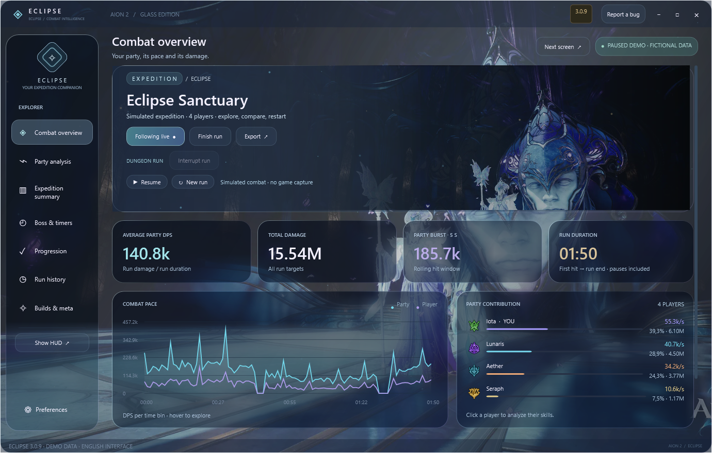
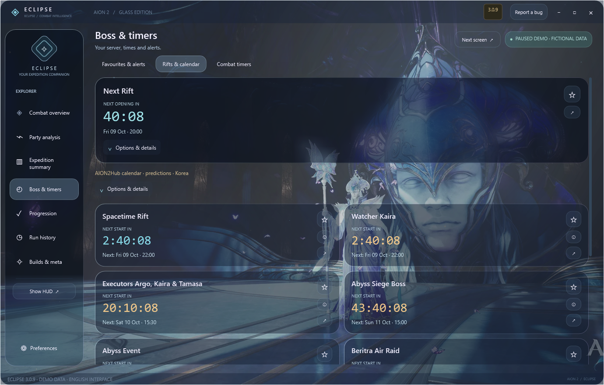
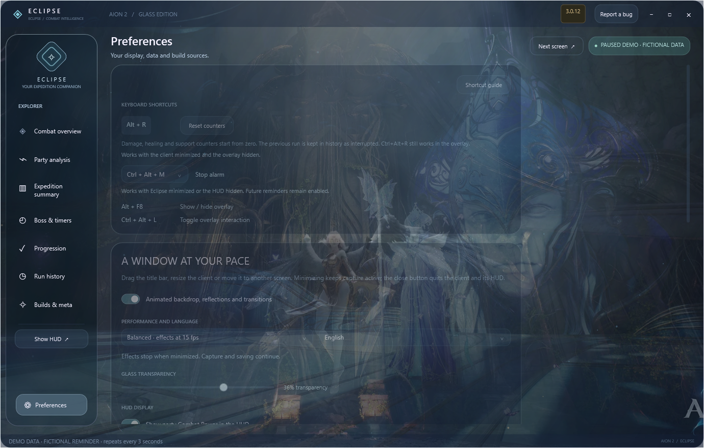
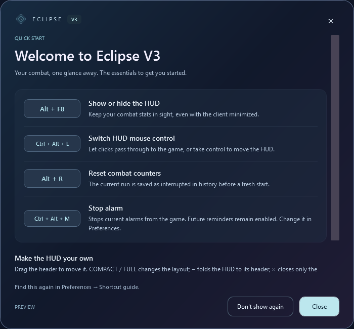

# Eclipse AION 2 DPS Meter — Live Party Overlay & Skill Analysis for Windows 10 & 11

    

---

Aion2-Eclipse is a free, Windows-native damage meter for AION 2 that combines a real-time party overlay with the full Glass desktop client. It tracks live DPS, HPS and shield application counts, breaks down skill usage and critical hits per member, and archives completed dungeon runs for later review. Saved encounters support interactive damage timelines, A/B build comparisons and personal build profiles with declared skill selections. Dedicated Rift timers, boss and event reminders, and an English interface round out a client built for continuous in-combat and post-run analysis.

## Features

- **Live party DPS overlay** — Real-time damage tracking for every party member, with DPS windows that reset after inactivity and run totals that persist. The HUD starts enabled and shares the client's measurement engine.
- **Collapsible overlay** — Reduce the HUD to a draggable header during fights and restore full or compact counters on demand. Measurements continue uninterrupted while collapsed.
- **Adaptive compact HUD** — Real class icons, aligned per-player healing, thinner damage bars and tighter rows that scale to larger observed rosters. Scroll to reach every received member.
- **Glass desktop client** — Translucent panels, animated AION artwork and Eclipse branding in a resizable client you can move across monitors or run silently at startup.
- **HUD visibility and mouse shortcuts** — Toggle the overlay with a configurable keyboard shortcut and switch click-through on or off without leaving the game. Occupied shortcuts are reported, and the client HUD button remains available as a fallback.
- **Focus recovery after Alt+Tab** — A visible HUD is automatically reordered above the game window when AION 2 regains focus, preserving position, dimensions, click-through state and run totals.
- **Party and skill analysis** — Inspect each member's damage, skill breakdown, critical hits, back attacks, maximum hits and received death counts. Nearby players outside the identified party are excluded.
- **Party healing and HPS** — Healing aligned per player, with full healing/HPS values, skill and recipient breakdowns, and zero-damage healers kept visible in the roster.
- **Shield application tracking** — Observed shield activations, received duration ranges and recipients across selected skills and classes, with group and companion notices grouped together.
- **Support buff analysis** — Observed activations, duration ranges, skills and recipients for selected beneficial buff families, with overlapping refreshes consolidated into a single observed sequence.
- **Self support detail** — Optional self-healing, self-shield and self-buff bars in compact and full views, with self healing already folded into total healing rather than counted twice.
- **Party Combat Power** — CP displayed beside each member when received from structured group information for the matching identity and server; missing values remain blank and the column can be disabled.
- **Server-aware character identity** — Characters sharing a nickname on different servers retain their own class and profile. Unknown class data is never guessed.
- **Expedition summary** — Total damage, duration, party contribution, burst windows, gaps between hits and target segments, paired with the declared build used for that run.
- **Interactive damage timeline** — Select a time range, inspect individual hits and locate strong five-second burst windows. Large runs retain complete totals and flag partial timeline coverage where relevant.
- **Run history** — Open any saved dungeon directly into its analysis: per-member totals with contribution bars, followed by skills, hits and timeline. Favourites, notes and interrupted runs remain available.
- **A/B build comparisons** — Compare completed runs with matching target, region, declared difficulty and personal class, and review observed DPS, critical-hit and back-attack deltas.
- **Personal build profiles** — Save class skill selections, notes, activity and region, with each run keeping a snapshot of the profile selected at the time.
- **Dated class meta** — Contextual class rankings with source, update date and regional uncertainty kept visible, alongside a separate local ranking built from your own runs.
- **Dedicated Rift timers** — Regional opening schedules with a fixed server clock and the next four local/UTC times, plus an independent reminder at ten minutes, five minutes or opening.
- **Boss and event timers** — Regional calendar entries, corrected boss intervals, Abyss events and PvP activities, with personal monster reminders and target segments.
- **Favourites and alerts** — Independent star and bell controls per followed entry, searchable and filterable, with reminders that continue while the client is minimized.
- **Alarm stop shortcut** — Stop the current alarm with the client minimized or the HUD hidden, using a configurable shortcut, while future reminders stay enabled.
- **Daily and weekly progression** — A per-character checklist with permanent goals, custom counters and manual Gear Score entry. Hide completed tasks and keep automatic completion limited to recognized dungeon victories.
- **English and French interface** — English on first launch, with client, overlay and setup labels switchable to French; the language choice is saved.
- **Performance controls** — Adjust transparency, animation quality and always-on-top behaviour, with visual effects pausing when minimized while capture, timers and saving continue.
- **Exports and diagnostics** — Export run data and a share card, or generate a restricted diagnostic report for support that excludes logs and authentication tokens.
- **Guided setup and updates** — Bundled application runtime, automatic prerequisite checks, consent-based driver installation when required, shortcuts and verified in-app update downloads.

## How It Works

Eclipse operates as a passive measurement layer alongside the AION 2 client. Once launched, it attaches to the local game process, reads the combat traffic already flowing through the client connection, and reconstructs damage, healing, and support events into per-player, per-skill records. No input is injected into the game and no separate account or game modification is required.

**Capture and attribution.** Incoming and outgoing combat packets are decoded and matched against the active party roster. Each event is attributed to a character using the identified nickname, server, and class, so members sharing a nickname on different servers retain independent profiles. Damage, critical hits, back attacks, maximum hits, deaths, healing, shield applications, and selected buff activations are recorded with timestamps and grouped by skill. Events observed outside the identified party are excluded from totals.

**Live processing.** A rolling window recomputes party DPS and HPS as events arrive; DPS returns to zero after two seconds without received positive damage and opens a fresh window on the next hit, while run totals persist. Health bars advance between server samples from observed damage rather than holding stale values. The overlay renders this state in real time and continues measuring when minimized, collapsed to its header, or hidden.

**Encounter segmentation.** Recognized bosses open separate encounters within a run. Supported final-boss deaths archive the encounter, reset live counters, and preserve a recovered summary; interrupted runs are retained rather than discarded. Current-boss damage and cumulative run totals are maintained side by side, and health-bar state is reconciled on confirmed deaths.

**Storage and analysis.** Completed and interrupted runs are written to a local history store together with the declared build profile, target, region, and difficulty. The client reads this store to produce member totals, contribution bars, skill breakdowns, timelines with selectable ranges and burst windows, and A/B comparisons between runs sharing the same target, region, difficulty, and class. Exports and the share card are generated from the same records.

**Timers and scheduling.** Rift, boss, and event schedules are evaluated against a fixed server clock using regional rules, then projected into local time for display. Reminders are scheduled independently per favourited entry at the selected offsets and fire while the client is minimized. Timer values are treated as dated community schedules rather than live spawn detections, and durations that cannot be confirmed remain unspecified.

**Configuration and diagnostics.** Preferences — overlay transparency, animation quality, always-on-top, click-through, shortcut bindings, language, and self-support visibility — are persisted locally and applied without restarting capture. Diagnostics can be exported as a restricted report that excludes logs and authentication tokens.

## Compatibility & Requirements

Eclipse is a native Windows desktop application built for 64-bit versions of Windows 10 and Windows 11. It runs alongside the AION 2 client as a standard desktop overlay and does not modify game files, inject into the game process, or require a separate Eclipse account.

**Operating system and architecture**
- Windows 10 (64-bit) or Windows 11 (64-bit). 32-bit Windows is not supported.
- Windows 10 version 1809 or later is recommended to ensure current runtime and overlay behavior.
- Administrative rights are required for first-time setup only, to install the bundled runtime and the packet capture driver.

**Runtime and drivers**
- A self-contained application runtime is included with the installer; no separate runtime download is needed.
- Network capture relies on the Npcap driver. Eclipse checks for it during guided setup and offers an official installation with explicit consent when it is missing. Npcap is provided by its own publisher and is not bundled.
- Packet capture operates on the local network interface only. No game client files are read, patched, or modified.

**Display and overlay**
- A standard Windows overlay is used. Exclusive fullscreen mode and Steam overlay integration are not supported; run AION 2 in windowed or borderless windowed mode for the HUD to appear above the game.
- Multiple monitors are supported, including placing the overlay on a second display. HUD position, dimensions, transparency, and click-through state are persisted between sessions.
- Hardware acceleration is recommended for the Glass client's translucency and animation effects. Visual quality can be reduced in Preferences on lower-end systems.

**Capture and measurement scope**
- Damage, healing, shield, and buff measurements depend on received network packets. Packet formats vary by region, and not every regional format is confirmed. Missing or altered packets can limit observation; zero received events do not prove zero activity occurred.
- Only identified party members are included in party analysis. Nearby players outside the identified party are excluded.
- Server-aware character identity keeps characters with the same nickname on different servers separate; unknown class data is not guessed.
- Overlay shortcuts (Alt+F8, Ctrl+Alt+L, Alt+M, Alt+R, and configurable alternatives) may conflict with other software. Occupied shortcuts are reported, and the client HUD button or Preferences remain available as fallbacks.

**Timers and regional data**
- Rift and boss timers use dated community schedules with a fixed server clock (Global/KR UTC+9, Taiwan UTC+8). Local daylight saving changes affect display only, never the server schedule.
- Timer entries are regional predictions, not live spawn detections, and travel portal durations remain unspecified where unconfirmed.
- Alarm reminders continue while the client is minimized or the HUD is hidden when the corresponding preference is enabled.

**Local data and storage**
- Settings, run history, build profiles, notes, favourites, and progression checklists are stored locally on the machine. No Eclipse account or cloud sync is required.
- Exports and share cards are generated locally. Diagnostic reports created for support exclude logs and authentication tokens.
- Closing the main client finalizes pending saves and stops capture; minimizing keeps collection running.

## 📸 Screenshot

## FAQ

**Is Eclipse free to use?**
Yes. Eclipse is distributed free of charge for Windows. There is no subscription, no account registration, and no premium tier gating the DPS meter, the Glass client, run history, or the analysis views.

**Does Eclipse require an account or login?**
No Eclipse account is required. Character and server identity are read from the game session so that party members with identical nicknames on different servers keep separate class data and profiles. Unknown class data is left unguessed rather than inferred.

**Which game regions and packet formats are supported?**
Eclipse reads structured group and combat information from the running AION 2 client on Windows x64. Regional packet formats are not universally confirmed, so observation coverage can vary by region. When a member's data is not received, the interface shows a placeholder rather than a fabricated value. Diagnostic exports can be produced from Preferences during an affected run to help identify missing formats.

**Why does a party member show partial or missing data?**
Measurements depend on structured information actually received for the matching identity and server. Missing Combat Power displays as "—". Zero received healing or shield events does not prove that none occurred. Nearby players who are not part of the identified party are excluded from party analysis by design.

**How is DPS calculated, and why does it reset?**
Live party DPS returns to 0 after two seconds without received positive damage and opens a fresh DPS window on the next hit. Run totals and received player levels remain available throughout. The HUD shares the client's measurement pipeline, so overlay and desktop values stay consistent.

**Does the overlay interfere with the game window?**
The HUD is a standard Windows overlay and is automatically reordered above the game when AION 2 regains focus after Alt+Tab. Position, dimensions, click-through state, and run totals are preserved; a deliberately hidden HUD stays hidden. Steam overlay and exclusive-fullscreen integration are not included.

**Which shortcuts are available?**
Alt+F8 shows or hides the HUD, Ctrl+Alt+L toggles click-through, Alt+R archives an interrupted run before resetting counters, and Alt+M stops current alarms with the client minimized or the HUD hidden. The alarm shortcut can be reassigned to Alt+F9 or Ctrl+Alt+M. Occupied shortcuts are reported, and the equivalent client buttons remain available.

**How are dungeon runs recognized and archived?**
Twenty-two activity entries are recognized. Supported final-boss deaths archive the run and reset live totals; interruptions retain a recovered summary. Automatic completion is limited to seven dungeons — all other finishes remain manual. Internal teleports preserve damage and the run.

**What do the healing, shield, and buff counters actually measure?**
Healing and HPS are tracked per player with skill and recipient breakdowns; self-healing is already included in total healing and is never counted twice. Shield tracking reports observed activations, received duration ranges, and recipients for selected skill families across six classes. Buff tracking covers eight selected beneficial families with observed activations and recipients. Effective healing, overheal, shield capacity, absorbed damage, shield destruction, and true uptime are not measured and are not presented as known values.

**Can I compare builds and review past runs?**
Yes. Completed runs can be compared when target, region, declared difficulty, and personal class match, showing observed DPS alongside critical-hit and back-attack changes. Personal build profiles store class skill selections, notes, activity, and region, and each run keeps a snapshot of the profile selected at the time. Run history opens directly into full analysis with per-member totals, contribution bars, skills, hits, and timeline.

**Are timers and boss alerts live detections?**
No. Rift timers, boss schedules, and event calendars are dated community schedules combined with a fixed server clock, not live spawn detection or official confirmation. Local daylight saving changes only the display, never the server schedule. Reminders for favourites and the Rift can fire at ten minutes before, five minutes before, or at the scheduled time, and continue while the client is minimized.

**What data leaves my machine?**
Run data, history, profiles, preferences, and progression checklists are stored locally. Diagnostic reports are restricted and exclude logs and authentication tokens. Combat logs and tokens are not uploaded automatically.

**How do updates work?**
Updates are offered in-app and downloaded as verified packages. Settings, history, and saved HUD position are preserved across updates. If an old class is still displayed after updating, keep the client open, teleport or change channels, then use two different active class skills within thirty seconds.

## Disclaimer

Aion2-Eclipse is provided as a free, community-developed measurement and analysis utility for Windows. It is offered in its current state, with no guarantee of uninterrupted operation, accuracy, or fitness for any particular purpose, and it is used entirely at your own risk.

Eclipse observes and interprets network traffic and local process data to produce its measurements. Reported values are derived estimates based on observed packets and client-side signals, not on authoritative server records. Consequently, damage, healing, HPS, shield application counts, buff duration ranges, CP values, critical-hit and back-attack rates, timelines, and summary totals may be incomplete, delayed, aggregated differently than the game's own reporting, or unavailable where a packet format is unrecognized or unsupported by a given regional client build. Zero received events do not prove that no activity occurred. Shield capacity, absorbed damage, destruction, and actual uptime are not measured; received duration ranges are observations, not guarantees.

Timer and calendar functions, including Rift timers, boss and event schedules, and associated reminders, are based on dated community references and fixed server clocks. They are predictions, not live spawn detections, and may differ from actual game conditions. Regional schedules, daylight-saving shifts, and unverified offsets are presented with their known uncertainty and should be confirmed in-game.

Saved runs, favourites, notes, build profiles, progression checklists, and preferences are stored locally on your machine. You are responsible for backing up any data you consider important. Eclipse may write logs and configuration files as part of normal operation; diagnostic reports are generated only on request and exclude logs and authentication tokens.

Eclipse is not affiliated with, endorsed by, or sponsored by the publisher or developer of AION 2. All game names, class names, skill names, and related marks remain the property of their respective owners.

Installing and running Eclipse, including any optional operating-system or packet-capture prerequisites it offers during setup, may interact with the game client and with your system's networking stack. You are responsible for ensuring that your use of the software complies with the game's terms of service, your regional regulations, and any applicable agreements. The authors and contributors accept no liability for account actions, data loss, system issues, or other damages arising from the download, installation, or use of Eclipse.

The in-app update mechanism downloads and verifies new builds on request; declining updates leaves you on your current version, and older versions may stop working as game protocols change. No warranty is made that any specific version remains compatible with current or future game builds.

Eclipse is distributed free of charge. It is not sold, and it should not be obtained from sources other than its official distribution channels.

## License

Eclipse is distributed as a free, closed-source Windows application. The compiled desktop client, its bundled runtime components, and the official setup package are provided as-is for personal, non-commercial use with AION 2. No license fee, subscription, or account registration is required to run the application or to receive in-app updates.

The following terms govern use of the application:

- **Grant of use.** You may install and run Eclipse on any number of Windows machines you personally operate. You may keep multiple installed versions side by side for testing or rollback purposes.
- **Restrictions.** You may not redistribute, sublicense, rent, lease, or sell the application or its setup package; may not reverse engineer, decompile, or disassemble the client except to the extent permitted by applicable law; and may not remove or alter proprietary notices, branding, or version identifiers embedded in the application.
- **Bundled components.** Eclipse includes third-party runtime and packet-capture prerequisites that remain subject to their own respective licenses. Those licenses apply to the bundled components independently of this section and are not modified by it.
- **Local data ownership.** All combat history, saved runs, build profiles, progression checklists, preferences, and exported reports are stored locally on your machine and remain yours. Eclipse does not claim ownership of measurement data generated on your system. Exported diagnostics exclude logs and authentication tokens by design.
- **Updates.** In-app updates are delivered as verified downloads and replace application binaries only. User settings, saved position, run history, and profiles are preserved across updates. Continued use of an updated build constitutes acceptance of the then-current license terms.
- **No warranty.** The application is provided without warranty of any kind, express or implied, including fitness for a particular purpose or non-infringement. Measurement accuracy depends on received packet coverage and supported regional formats, and observed values may be incomplete.
- **Limitation of liability.** In no event shall the authors be liable for any indirect, incidental, special, or consequential damages arising from use of or inability to use the application, including lost run data or missed timers.
- **Termination.** This grant terminates automatically if you breach its restrictions. On termination you must cease use and remove installed copies.

Use of Eclipse is also subject to the project's published disclaimer regarding third-party game terms of service, which is presented separately in this document.

